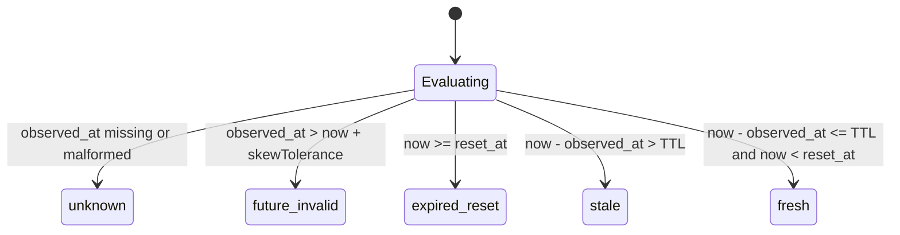

# Invariant INV-AR-004: Observation Freshness and Metric Degradation

Standard: `wellmanifest/account-runtime`  
Classification: Normative Invariant (`INV-AR-004`)  
Provenance: Lessons learned from `semcod/monag` (Ticket-110) and multi-agent distributed dispatch  

---

## 1. Context and Problem Statement

Autonomous agent runtimes and orchestrators consume token and financial budgets provided by upstream LLM hosting providers. Because provider API quota endpoints are queried asynchronously, local cache stores frequently hold observations that have drifted:

1. **Stale Usage Projections**: An observation made 48 hours ago may show $95 remaining balance, whereas concurrent execution has already exhausted the quota. Treating this balance as valid leads to repeated runtime exceptions (HTTP 429 / Insufficient Quota).
2. **Expired Reset Windows**: Many providers reset usage daily or monthly (at `reset_at`). If an observation was taken before the reset timestamp, the actual provider quota has replenished, but a cached exhausted record prevents dispatch (starvation).
3. **Clock Skew and Fabricated Future Timestamps**: Observations carrying future timestamps due to unsynchronized clocks or corruption must not be accepted as fresh.
4. **Missing or Corrupt Observation Timestamps**: An observation lacking a verified timestamp cannot be distinguished from static, unverified assumptions.

---

## 2. Normative Specification

### Rule 1: Mandatory ISO 8601 Observation Timestamp
Every usage observation, token ledger entry, and account quota record MUST include:
- `observed_at`: An immutable ISO 8601 UTC timestamp (e.g. `2026-10-11T12:00:00Z`).
- `reset_at` (optional): The ISO 8601 UTC timestamp at which provider quotas reset.

### Rule 2: Freshness State Transition
An observation evaluates to one of five deterministic states:

- **`fresh`**: The observation was recorded within the declared time-to-live ($\Delta t \le \text{TTL}$, default 24h) and the provider reset window has not passed ($T_{\text{now}} < T_{\text{reset}}$).
- **`stale`**: The elapsed time since observation exceeds the freshness threshold ($\Delta t > \text{TTL}$).
- **`expired_reset`**: The provider reset time has elapsed ($T_{\text{now}} \ge T_{\text{reset}}$), requiring an authoritative provider query.
- **`future_invalid`**: The observation timestamp lies in the future beyond acceptable clock skew ($\Delta t < -\text{skewTolerance}$).
- **`unknown`**: The timestamp is missing, malformed, or unparseable.

### Rule 3: Graceful Degradation of Effective Balance
When an observation is in any state other than `fresh`:
1. The **`effective_remaining`** balance MUST degrade to `null` / `UNKNOWN`.
2. The runtime scheduler, dispatcher, or account rotator MUST NOT treat the balance as zero, infinite, or available.
3. The scheduler MUST trigger an asynchronous preflight refresh probe before dispatching budget-consuming work.

### Rule 4: Decoupling of Historic Auditing from Live Dispatch
Implementations MUST preserve the last measured value in:
- `last_observed_remaining` (or `historical_remaining`)
This value is strictly intended for human review, historical dashboards, and trend analysis. It MUST NOT be used by automated decision engines as a proxy for live quota.
